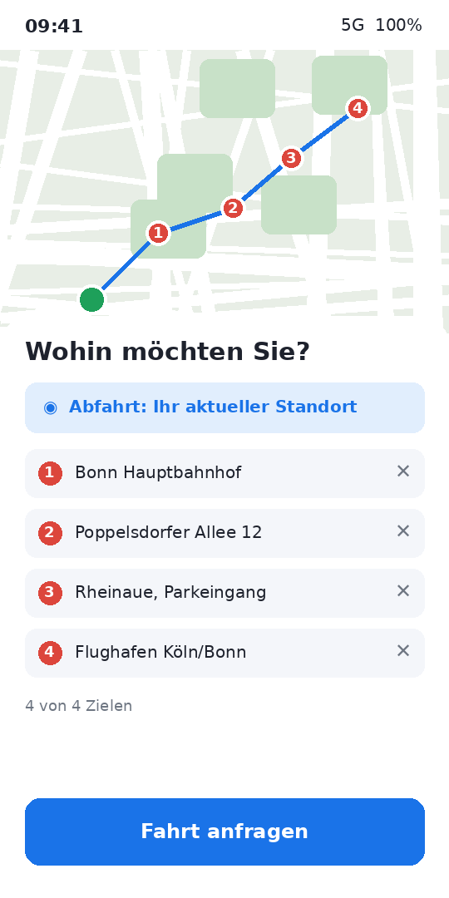
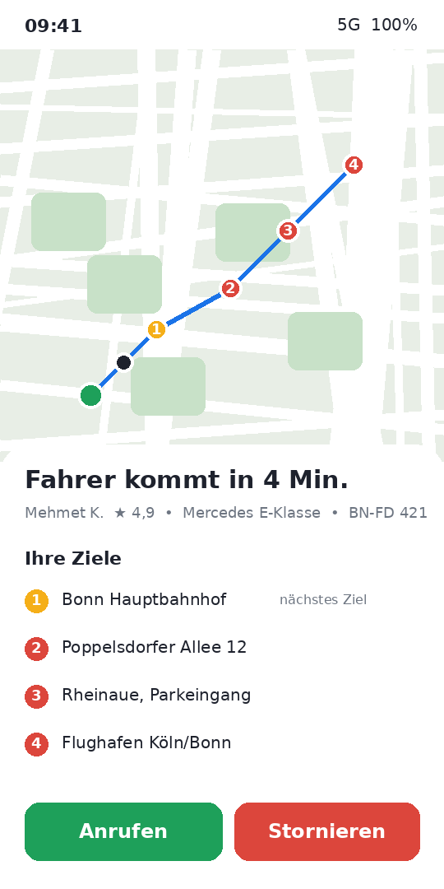
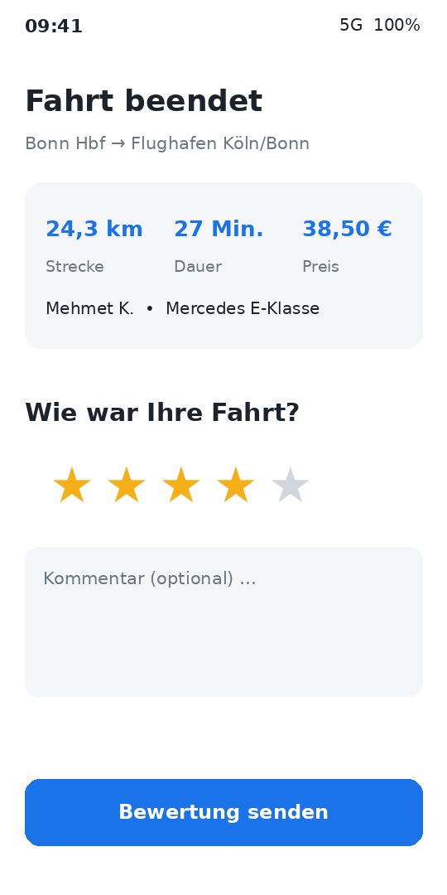
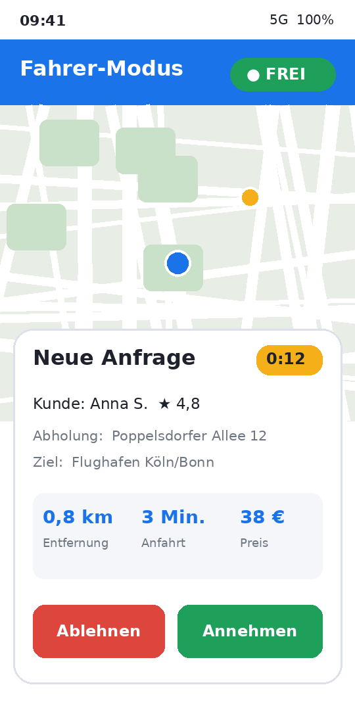
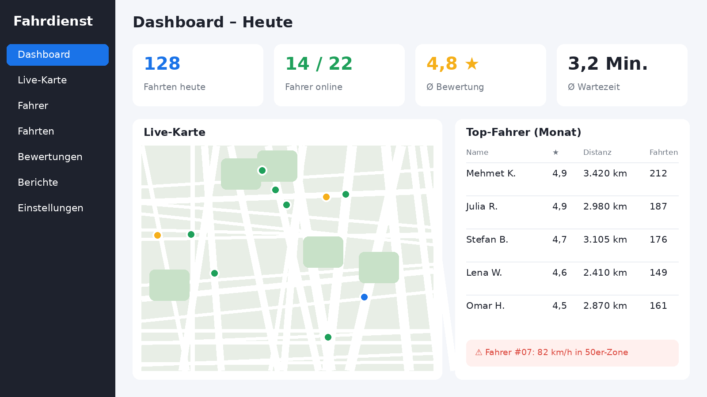
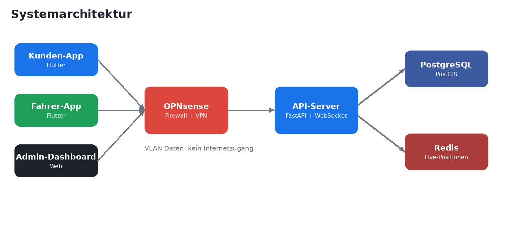

# 🚕 Fahrdienst – Dispatch- und Verwaltungssystem

Ein System für den eigenen Kunden-Fahrdienst: Kunden fordern eine Fahrt an, der nächste freie Fahrer übernimmt sie, der Kunde sieht ETA und Live-Position, und die Verwaltung behält Geschwindigkeit, Kilometer und Bewertungen im Blick.

> **Status:** Prototyp / Grundgerüst (v0.1). Die Bilder unten sind **Design-Vorschauen (Mockups)** und keine echten App-Screenshots. Ersetzen Sie sie nach dem ersten Build durch echte Screenshots (siehe [Screenshots ersetzen](#screenshots-ersetzen)).

## Funktionen

- **Kunde:** Fahrt anfragen, Fahrer mit Bewertung und ETA sehen, Live-Tracking, Fahrer bewerten
- **Fahrer:** Status *frei/offline*, Anfragen in der Nähe annehmen oder ablehnen, Position und Geschwindigkeit werden übertragen
- **Anmeldung:** Login mit Rollen (Kunde, Fahrer, Admin), Details in [docs/AUTH.md](docs/AUTH.md)
- **Admin:** Live-Karte, gefahrene Kilometer, Geschwindigkeit, Fahrtenanzahl, Bewertungen, Warnungen
- **Abfahrt und Ziele:** Die Abfahrt ist automatisch der aktuelle GPS-Standort des Kunden. Pro Fahrt sind **1 bis 4 Ziele** möglich, die der Reihe nach angefahren werden. Der Fahrer meldet jedes erreichte Ziel, nach dem letzten endet die Fahrt.
- **Zuweisung:** Anfrage geht an den nächsten freien Fahrer im Umkreis (5 km), bei Ablehnung oder Timeout an den nächsten

## Screenshots

### Kunden-App

| Fahrt anfragen (Abfahrt + 4 Ziele) | Live-Tracking mit Zielliste | Bewertung |
|:---:|:---:|:---:|
|  |  |  |

### Fahrer-App

| Neue Anfrage |
|:---:|
|  |

### Admin-Dashboard



## Architektur



Die Datenbank läuft in einem eigenen VLAN hinter OPNsense, siehe [docs/OPNSENSE.md](docs/OPNSENSE.md).

## Projektstruktur

```
fahrdienst/
├── flutter_app/          Flutter-App (Kunde + Fahrer)
│   ├── pubspec.yaml
│   └── lib/
│       ├── main.dart
│       ├── models/ride.dart
│       ├── services/api_service.dart
│       └── screens/      customer_home, tracking_screen, driver_home
├── backend/              FastAPI + PostgreSQL/PostGIS + Redis
│   ├── app/main.py
│   ├── schema.sql
│   ├── docker-compose.yml
│   └── Dockerfile
└── docs/                 Bilder und OPNsense-Anleitung
```

## Installation

### Backend

```bash
cd backend
cp .env.example .env        # ALLE Werte ändern: Passwörter, JWT_SECRET (openssl rand -hex 32), Admin-Zugang
docker compose up -d
# API: http://localhost:8000/docs
```

### Flutter-App

```bash
cd flutter_app
flutter create .            # erzeugt android/ und ios/ Ordner
flutter pub get
flutter run
```

Standortberechtigung eintragen:

- **Android:** in `android/app/src/main/AndroidManifest.xml` die Berechtigungen `ACCESS_FINE_LOCATION` und `ACCESS_COARSE_LOCATION` hinzufügen
- **iOS:** in `ios/Runner/Info.plist` den Schlüssel `NSLocationWhenInUseUsageDescription` mit einem Erklärungstext hinzufügen

Die API-Adresse wird beim Start übergeben (es gibt keine echte Domain im Code):

| Gerät | Befehl |
|---|---|
| Android-Emulator | `flutter run` (Standard: `http://10.0.2.2:8000`) |
| Echtes Handy im WLAN | `flutter run --dart-define=API_URL=http://<IP-des-PCs>:8000` |
| Flutter Web / Chrome | `flutter run -d chrome --dart-define=API_URL=http://localhost:8000` |
| Produktion | `--dart-define=API_URL=https://ihre-domain.de` |

**Fehler „failed to fetch“?** Prüfen: Läuft das Backend (`http://localhost:8000/health` im Browser)? Stimmt die IP, und erlaubt die Firewall Port 8000? Bei Klartext-HTTP auf Android 9+ in `AndroidManifest.xml` `android:usesCleartextTraffic="true"` setzen (nur zum Testen, in Produktion HTTPS verwenden).

Google-Maps-Schlüssel nach Bedarf eintragen. Beim ersten Start legt das Backend das Admin-Konto aus `ADMIN_EMAIL` und `ADMIN_PASSWORD` in `.env` an. Fahrer legt der Admin in der App an, Kunden registrieren sich selbst.

## So testen Sie den Ablauf (Admin, Fahrer, Kunde)

1. Backend frisch starten (nach Änderungen an der Datenbank zuerst `docker compose down -v`, das löscht alle Daten):
   ```bash
   cd backend && cp .env.example .env     # Werte in .env ausfüllen
   docker compose up -d --build
   ```
2. App in **drei getrennten Browser-Fenstern** starten, jeweils mit eigenem Port (sonst teilen sie sich die Anmeldung):
   ```bash
   flutter run -d chrome --web-port 8080 --dart-define=API_URL=http://localhost:8000   # Admin
   flutter run -d chrome --web-port 8081 --dart-define=API_URL=http://localhost:8000   # Fahrer
   flutter run -d chrome --web-port 8082 --dart-define=API_URL=http://localhost:8000   # Kunde
   ```
3. **Admin:** mit `ADMIN_EMAIL` und `ADMIN_PASSWORD` anmelden, „Fahrer anlegen“ (Name, E-Mail, Start-Passwort, Fahrzeug, Kennzeichen).
4. **Fahrer:** mit den Daten des Admins anmelden, Schalter auf **FREI**, Standortfreigabe erlauben.
5. **Kunde:** „Neu hier? Als Kunde registrieren“, dann 1 bis 4 Ziele eingeben und „Fahrt anfragen“.
6. Beim Fahrer erscheint die Anfrage mit Countdown (15 Sek.). **Annehmen** ordnet die Fahrt zu, **Ablehnen** oder Ablauf schaltet zum nächsten Fahrer weiter. Danach „Kunde abgeholt“ und pro Ziel „Ziel N erreicht“. Der Admin sieht Status, Fahrten, Kilometer und Geschwindigkeit des Fahrers, der Kunde kann bewerten.

**Bekommt der Fahrer keine Anfrage?** Er muss auf FREI stehen, seine Position gemeldet haben und höchstens `DISPATCH_RADIUS_M` (Standard 5 km) vom Kunden entfernt sein. Zum Testen am selben Rechner ist der Abstand fast null.

## Screenshots ersetzen

1. App im Emulator starten (`flutter run`)
2. Screenshot erstellen, zum Beispiel mit `adb exec-out screencap -p > docs/images/01_kunde_anfrage.png`
3. Dateien in `docs/images/` mit gleichem Namen überschreiben

## Noch offen (Roadmap)

- [ ] Zielsuche mit Adressvorschlägen (Geocoding), damit `lat`/`lng` der Ziele automatisch gesetzt werden
- [ ] Route und ETA über alle Ziele hinweg berechnen
- [x] Login mit Rollen (JWT, bcrypt, Sperre nach Fehlversuchen)
- [ ] Passwort selbst ändern, Passwort vergessen, Zwei-Faktor für Admins
- [ ] Push-Benachrichtigung (Firebase) statt Abfrage alle 2 Sekunden (Polling)
- [ ] Google-Map-Widget und Live-Marker im Tracking-Screen
- [ ] Echtzeit per WebSocket statt Polling, Live-Position des Fahrers auf der Karte
- [ ] ETA-Berechnung (Google Directions, Mapbox oder OSRM)
- [ ] Admin-Dashboard (React) mit echten Daten
- [ ] Geschwindigkeitswarnungen und Statistik-Auswertungen
- [ ] Zahlungen

## Rechtliches (Deutschland)

- **DSGVO:** Standort- und Geschwindigkeitsüberwachung von Fahrern ist Beschäftigtendatenschutz. Rechtsgrundlage klären, gegebenenfalls Betriebsrat einbinden, Positionsdaten nach fester Frist löschen (siehe Kommentar in `schema.sql`).
- **PBefG:** Entgeltliche Personenbeförderung braucht in der Regel eine Genehmigung. Vorab mit der zuständigen Behörde oder einem Anwalt klären.

## Lizenz

MIT, siehe [LICENSE](LICENSE). Bitte Namen in der Lizenzdatei anpassen.
