# 🚕 Fahrdienst – Dispatch- und Verwaltungssystem

Ein System für den eigenen Kunden-Fahrdienst: Kunden fordern eine Fahrt an, der nächste freie Fahrer übernimmt sie, der Kunde sieht ETA und Live-Position, und die Verwaltung behält Geschwindigkeit, Kilometer und Bewertungen im Blick.

> **Status:** Prototyp / Grundgerüst (v0.1). Die Bilder unten sind **Design-Vorschauen (Mockups)** und keine echten App-Screenshots. Ersetzen Sie sie nach dem ersten Build durch echte Screenshots (siehe [Screenshots ersetzen](#screenshots-ersetzen)).

## Funktionen

- **Kunde:** Fahrt anfragen, Fahrer mit Bewertung und ETA sehen, Live-Tracking, Fahrer bewerten
- **Fahrer:** Status *frei/offline*, Anfragen in der Nähe annehmen oder ablehnen, Position und Geschwindigkeit werden übertragen
- **Navigation (Fahrer):** Ein Tippen öffnet Google Maps, Apple Karten oder Waze zum Kunden und danach zu jedem Ziel
- **Tarife und Preis vor der Buchung:** Anfahrtskosten 4 € (Normalfahrzeug) oder 10 € (Rollstuhlfahrzeug) plus Kilometer, Abrechnung nach Kilometern oder per **Taxischein**. Der Kunde sieht den Preis vor der Buchung. Details in [docs/PREISE_PARTNER_QUITTUNG.md](docs/PREISE_PARTNER_QUITTUNG.md)
- **Partnerfirmen:** Der Admin fügt Firmen mit eigenen Fahrern hinzu. Bei einem Partnerfahrer zahlt der Kunde nur eine Servicegebühr (3 bis 6 €), die Firma zahlt pro Fahrt 3 €. Monatsabrechnung als CSV
- **Quittung als PDF:** Nach der Fahrt lädt der Kunde seine Quittung herunter
- **Geteilte Fahrten und Preise:** Der Kunde sucht Ziele per Adresssuche, sieht Einzel- und Sparpreis und kann „Fahrt teilen“ wählen. Das System legt passende Fahrgäste in einem Fahrzeug zusammen, der Admin sieht gesparte Kilometer und Kosten. Details in [docs/TEILEN.md](docs/TEILEN.md)
- **Musik im Fahrzeug:** Der Admin pflegt Bibliotheken und lädt Titel hoch (mit Lizenznachweis), der Fahrer startet die Playlist, pausiert, überspringt und mischt
- **Zeitungen (Kunde):** Während der Fahrt liest der Kunde Schlagzeilen aus den vom Admin hinterlegten Zeitungs-Feeds, Details in [docs/FUNKTIONEN.md](docs/FUNKTIONEN.md)
- **Anmeldung:** Login mit Rollen (Kunde, Fahrer, Admin), Details in [docs/AUTH.md](docs/AUTH.md)
- **Admin:** Live-Karte, gefahrene Kilometer, Geschwindigkeit, Fahrtenanzahl, Bewertungen, Warnungen
- **Abfahrt und Ziele:** Die Abfahrt ist automatisch der aktuelle GPS-Standort des Kunden. Pro Fahrt sind **1 bis 4 Ziele** möglich, die der Reihe nach angefahren werden. Der Fahrer meldet jedes erreichte Ziel, nach dem letzten endet die Fahrt.
- **Zuweisung:** Anfrage geht an den nächsten freien Fahrer im Umkreis (5 km) mit passendem Fahrzeugtyp, unsere eigenen Fahrer zuerst, Partnerfahrer nur wenn der Kunde sie erlaubt. Bei Ablehnung oder Timeout an den nächsten

## Screenshots

Die Bilder sind **Design-Vorschauen (Mockups)** und keine echten App-Screenshots. Ausnahme: Die **Quittung** ist ein echtes PDF, das das System erzeugt hat (als Bild dargestellt).

### Kunden-App

| Buchung mit Preis, Fahrzeug, Zahlung, Teilen | Live-Tracking mit Zielliste | Bewertung |
|:---:|:---:|:---:|
| 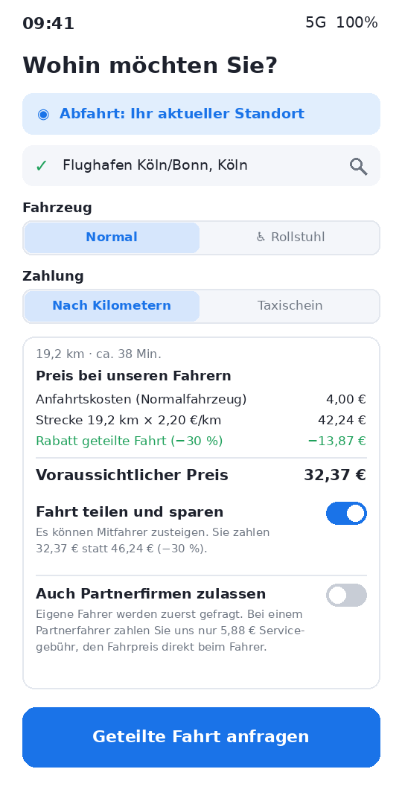 | 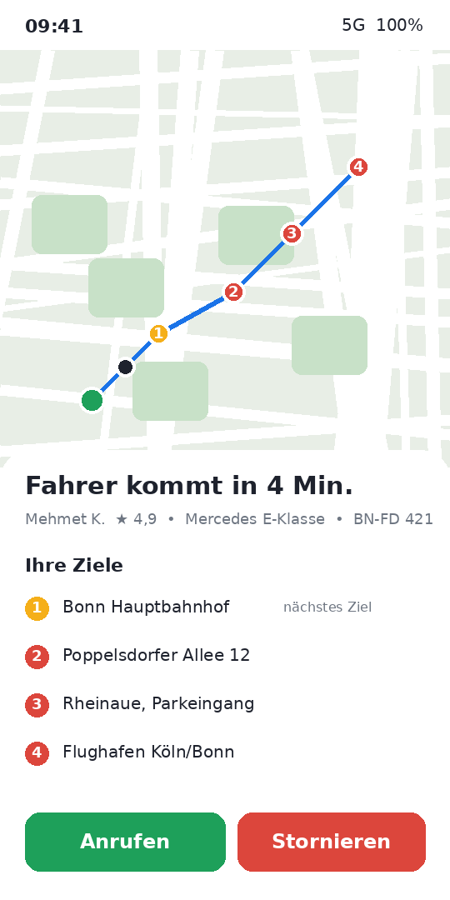 | 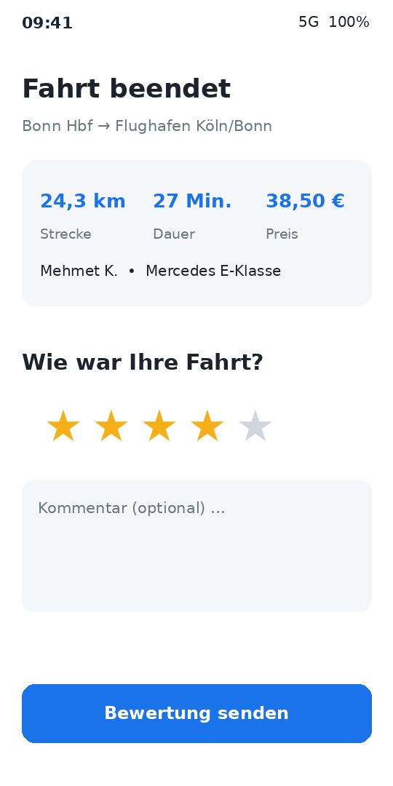 |

### Fahrer-App

| Neue Anfrage | Route mit zwei Fahrgästen, Zahlungshinweis, Musik |
|:---:|:---:|
| 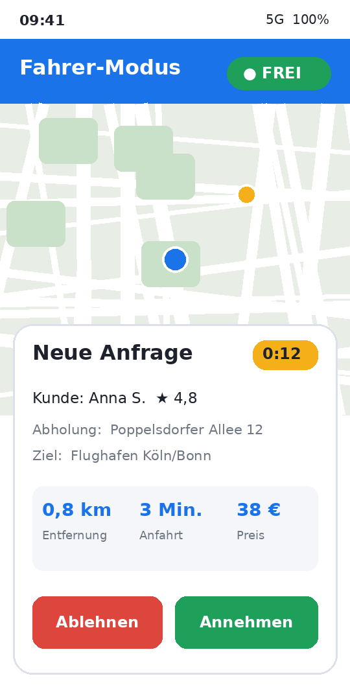 | 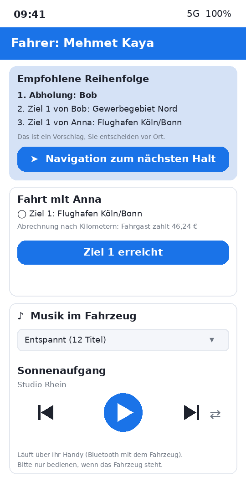 |

### Quittung als PDF (echtes Ergebnis)

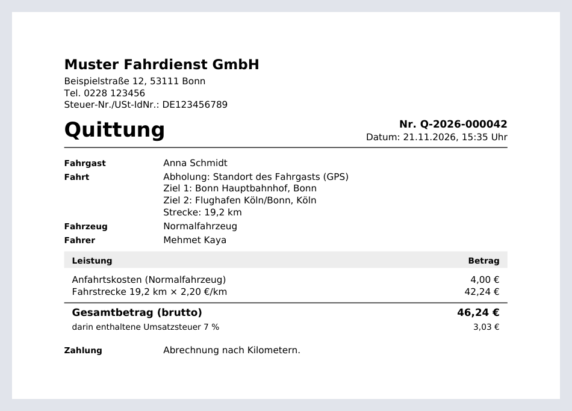

### Geteilte Fahrt

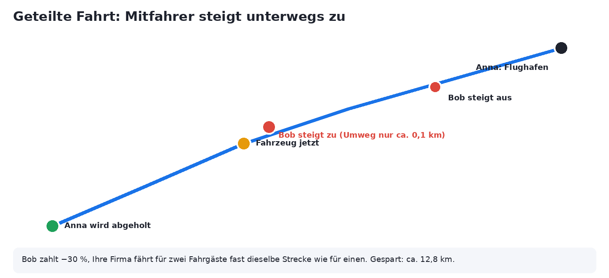

### Admin-Webseite

Die Webseite läuft direkt im Backend: **`http://localhost:8000/dashboard`** (in Produktion `https://ihre-domain.de/dashboard`). Anmeldung mit dem Admin-Konto aus `.env`. Sie enthält:

- **Live:** Kennzahlen (Fahrten, Fahrer, Bewertung, zusammengelegte Fahrten, gesparte Kosten, Umsatz, Partnergebühren), Karte mit allen aktiven Fahrern, alle 5 Sekunden aktualisiert
- **Fahrer:** Tabelle mit Status, Firma, Fahrzeugtyp, Bewertung, Fahrten, Kilometern, Geschwindigkeit. Fahrer anlegen (Normal- oder Rollstuhlfahrzeug, eigener Fahrer oder Partnerfirma), sperren, Passwort zurücksetzen
- **Firmen:** Partnerfirmen anlegen, Gebühr pro Fahrt, ein-/ausschalten, Monatsabrechnung mit CSV-Download
- **Fahrten:** letzte Fahrten mit Preis, Rollstuhl, Taxischein, Firma und Quittungsnummer
- **Bewertungen**, **Geschwindigkeit** (Überschreitungen mit Link zum Ort)
- **Musik:** Bibliotheken anlegen, MP3 hochladen, anhören, löschen (Lizenznachweis Pflicht)
- **Zeitungen:** RSS-Feeds eintragen, ein- und ausschalten, Vorschau
- **Preise & Teilen:** Tarife, Rabatt, Servicegebühr, Steuersätze, Firmenangaben für die Quittung

| Live | Firmen | Preise & Teilen |
|:---:|:---:|:---:|
| 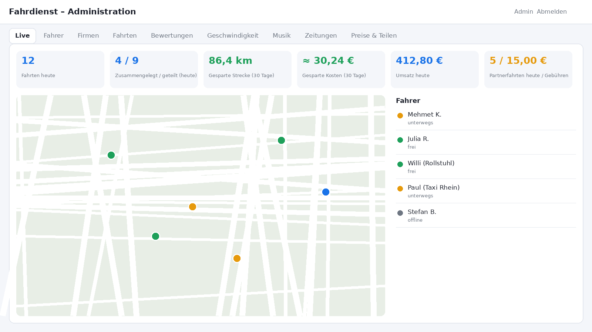 | 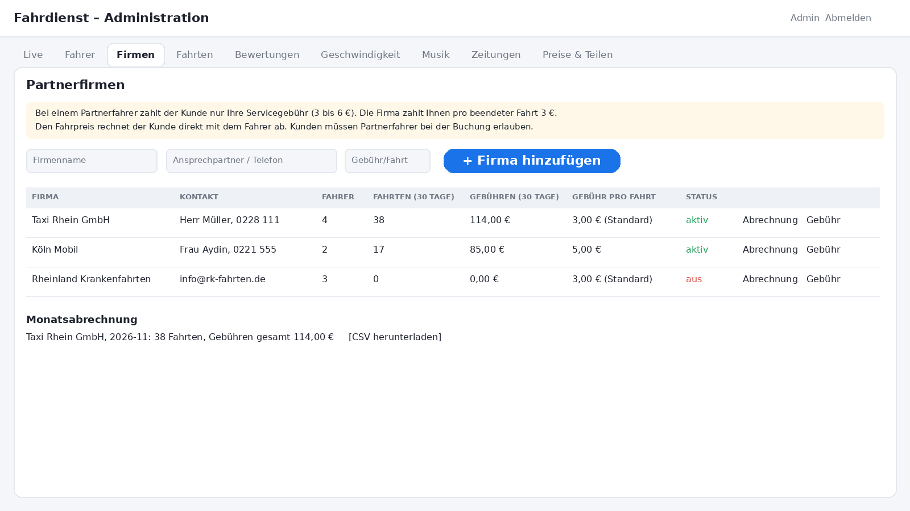 | 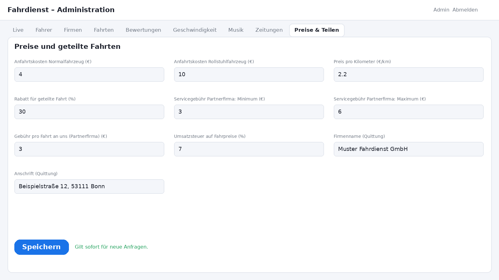 |

Zusätzlich gibt es in der Flutter-App einen einfachen Admin-Bildschirm für unterwegs.

## Architektur

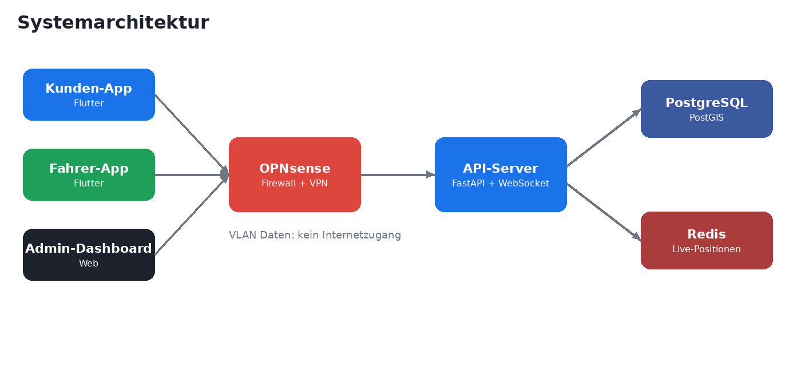

Die Datenbank läuft in einem eigenen VLAN hinter OPNsense, siehe [docs/OPNSENSE.md](docs/OPNSENSE.md).

## Projektstruktur

```
fahrdienst/
├── flutter_app/          Flutter-App (Kunde + Fahrer)
│   ├── pubspec.yaml
│   └── lib/
│       ├── main.dart
│       ├── models/ride.dart
│       ├── services/api_service.dart
│       └── screens/      customer_home, tracking_screen, driver_home
├── backend/              FastAPI + PostgreSQL/PostGIS + Redis
│   ├── app/              main.py (API), auth.py (Login/Rollen), db.py
│   ├── app/              music.py (Musik), news.py (Zeitungen), pooling.py (Fahrten teilen),
│   │                     pricing.py (Preise), geo.py (Adresssuche),
│   │                     receipt.py (Quittung als PDF), fonts/ (Schrift für das PDF)
│   ├── migrations/       SQL zum Aktualisieren einer bestehenden Datenbank
│   ├── admin/            Admin-Webseite (index.html, static/app.js, Leaflet)
│   ├── schema.sql
│   ├── docker-compose.yml
│   └── Dockerfile
└── docs/                 Bilder und OPNsense-Anleitung
```

## Installation

### Backend

```bash
cd backend
cp .env.example .env        # ALLE Werte ändern: Passwörter, JWT_SECRET (openssl rand -hex 32), Admin-Zugang
docker compose up -d
# API: http://localhost:8000/docs
```

### Flutter-App

```bash
cd flutter_app
flutter create .            # erzeugt android/ und ios/ Ordner
flutter pub get
flutter run
```

**Navigation, Musik und Zeitungen** brauchen zusätzlich `flutter pub get`. Damit Musik und Standort weiterlaufen, wenn der Fahrer die Navigation öffnet, richten Sie einmalig den Hintergrundbetrieb ein ([docs/FUNKTIONEN.md](docs/FUNKTIONEN.md), Abschnitt 4) und starten dann mit `--dart-define=BACKGROUND_MODE=true`.

Standortberechtigung eintragen:

- **Android:** in `android/app/src/main/AndroidManifest.xml` die Berechtigungen `ACCESS_FINE_LOCATION` und `ACCESS_COARSE_LOCATION` hinzufügen
- **iOS:** in `ios/Runner/Info.plist` den Schlüssel `NSLocationWhenInUseUsageDescription` mit einem Erklärungstext hinzufügen

Die API-Adresse wird beim Start übergeben (es gibt keine echte Domain im Code):

| Gerät | Befehl |
|---|---|
| Android-Emulator | `flutter run` (Standard: `http://10.0.2.2:8000`, so erreicht der Emulator Ihren Rechner) |
| Browser (Chrome) | `flutter run -d chrome` (Standard: `http://localhost:8000`) |
| Echtes Handy im WLAN | `flutter run --dart-define=API_URL=http://<IP-des-PCs>:8000` |
| Flutter Web / Chrome | `flutter run -d chrome --dart-define=API_URL=http://localhost:8000` |
| Produktion | `--dart-define=API_URL=https://ihre-domain.de` |

**Fehler „Failed to fetch“ oder „Server nicht erreichbar“?** Die Adresse `10.0.2.2` funktioniert nur im Android-Emulator, nie im Browser. Prüfen: Läuft das Backend (`http://localhost:8000/health` im Browser)? Stimmt die IP, und erlaubt die Firewall Port 8000? Bei Klartext-HTTP auf Android 9+ in `AndroidManifest.xml` `android:usesCleartextTraffic="true"` setzen (nur zum Testen, in Produktion HTTPS verwenden).

Google-Maps-Schlüssel nach Bedarf eintragen. Beim ersten Start legt das Backend das Admin-Konto aus `ADMIN_EMAIL` und `ADMIN_PASSWORD` in `.env` an. Fahrer legt der Admin in der App an, Kunden registrieren sich selbst.

## So testen Sie den Ablauf (Admin, Fahrer, Kunde)

1. Backend frisch starten (nach Änderungen an der Datenbank zuerst `docker compose down -v`, das löscht alle Daten):
   ```bash
   cd backend && cp .env.example .env     # Werte in .env ausfüllen
   docker compose up -d --build
   ```
2. App in **drei getrennten Browser-Fenstern** starten, jeweils mit eigenem Port (sonst teilen sie sich die Anmeldung):
   ```bash
   flutter run -d chrome --web-port 8080 --dart-define=API_URL=http://localhost:8000   # Admin
   flutter run -d chrome --web-port 8081 --dart-define=API_URL=http://localhost:8000   # Fahrer
   flutter run -d chrome --web-port 8082 --dart-define=API_URL=http://localhost:8000   # Kunde
   ```
3. **Admin:** im Browser `http://localhost:8000/dashboard` öffnen und mit `ADMIN_EMAIL` und `ADMIN_PASSWORD` anmelden. Unter „Preise & Teilen“ den Kilometerpreis und Ihre Firmenangaben eintragen. Unter „Fahrer“ einen Fahrer anlegen (Name, E-Mail, Start-Passwort, Fahrzeug, Kennzeichen, Fahrzeugtyp). Optional unter „Firmen“ eine Partnerfirma anlegen und einen Fahrer dieser Firma anlegen.
4. **Fahrer:** mit den Daten des Admins anmelden, Schalter auf **FREI**, Standortfreigabe erlauben.
5. **Kunde:** „Neu hier? Als Kunde registrieren“, bei jedem Ziel (bis zu 4) auf die **Lupe** tippen und die Adresse wählen. Dann erscheint der Preis. Fahrzeug, Zahlungsart (Kilometer oder Taxischein), „Fahrt teilen“ und „Partnerfirmen zulassen“ wählen und „Fahrt anfragen“.
6. Beim Fahrer erscheint die Anfrage mit Countdown (15 Sek.). **Annehmen** ordnet die Fahrt zu, **Ablehnen** oder Ablauf schaltet zum nächsten Fahrer weiter. Danach „Kunde abgeholt“ und pro Ziel „Ziel N erreicht“. Der Admin sieht Status, Fahrten, Kilometer und Geschwindigkeit des Fahrers. Nach der Fahrt kann der Kunde bewerten und die **Quittung als PDF** herunterladen.

**Bekommt der Fahrer keine Anfrage?** Er muss auf FREI stehen, seine Position gemeldet haben und höchstens `DISPATCH_RADIUS_M` (Standard 5 km) vom Kunden entfernt sein. Zum Testen am selben Rechner ist der Abstand fast null.

## Screenshots ersetzen

1. App im Emulator starten (`flutter run`)
2. Screenshot erstellen, zum Beispiel mit `adb exec-out screencap -p > docs/images/01_kunde_anfrage.png`
3. Dateien in `docs/images/` mit gleichem Namen überschreiben

## Noch offen (Roadmap)

- [x] Navigation, Musik-Player und Zeitungen (Details in `docs/FUNKTIONEN.md`)
- [x] Adresssuche (Geocoding) mit Koordinaten für die Ziele
- [x] Geteilte Fahrten mit Preisen und Ersparnis-Auswertung (`docs/TEILEN.md`)
- [x] Tarife (Anfahrtskosten, Rollstuhl, Taxischein), Partnerfirmen mit Gebühren, Quittung als PDF (`docs/PREISE_PARTNER_QUITTUNG.md`)
- [ ] Echte Routen (OSRM/Routing-Dienst) statt Luftlinie, Vorausplanung von Sammelfahrten
- [ ] Zahlungssystem (Karte, Rechnung, Abbuchung), Rechnungen mit allen Pflichtangaben, eigenes Portal für Partnerfirmen
- [ ] Route und ETA über alle Ziele hinweg berechnen
- [x] Login mit Rollen (JWT, bcrypt, Sperre nach Fehlversuchen)
- [ ] Passwort selbst ändern, Passwort vergessen, Zwei-Faktor für Admins
- [ ] Push-Benachrichtigung (Firebase) statt Abfrage alle 2 Sekunden (Polling)
- [ ] Google-Map-Widget und Live-Marker im Tracking-Screen
- [ ] Echtzeit per WebSocket statt Polling, Live-Position des Fahrers auf der Karte
- [ ] ETA-Berechnung (Google Directions, Mapbox oder OSRM)
- [x] Admin-Webseite mit Live-Karte, Fahrerliste, Fahrten, Bewertungen, Geschwindigkeit
- [ ] Musik: Offline-Zwischenspeicher auf dem Handy, Verwaltung auch in der Flutter-App
- [ ] Admin: Export (CSV), Berichte pro Zeitraum, Kunden-Verwaltung
- [ ] Geschwindigkeitswarnungen und Statistik-Auswertungen

## Rechtliches (Deutschland)

- **DSGVO:** Standort- und Geschwindigkeitsüberwachung von Fahrern ist Beschäftigtendatenschutz. Rechtsgrundlage klären, gegebenenfalls Betriebsrat einbinden, Positionsdaten nach fester Frist löschen (siehe Kommentar in `schema.sql`).
- **PBefG:** Entgeltliche Personenbeförderung braucht in der Regel eine Genehmigung. Das gilt auch für das Bündeln von Fahrgästen und die Vermittlung an Partnerfirmen. Vorab mit der zuständigen Behörde oder einem Anwalt klären.
- **Steuern und Quittungen:** Die Steuersätze in den Einstellungen sind Platzhalter. Quittung, Rechnung und Aufbewahrung mit dem Steuerberater abstimmen.
- **Musik:** Wiedergabe für Fahrgäste ist in der Regel lizenzpflichtig (siehe `docs/FUNKTIONEN.md`).

## Lizenz

MIT, siehe [LICENSE](LICENSE). Bitte Namen in der Lizenzdatei anpassen.
